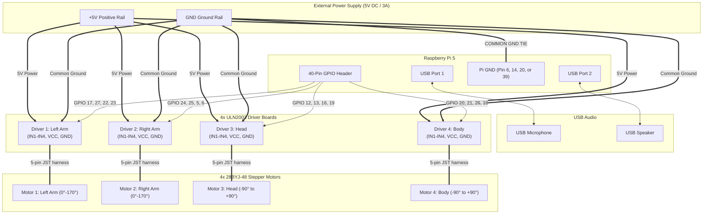

# Complete Hardware Wiring Diagram: Raspberry Pi 5 4-Motor Robot

This document details the complete wiring layout for the 4x ULN2003 stepper motor drivers, 28BYJ-48 stepper motors, external power supply, USB microphone, and USB speaker.

---

## 1. System Architecture & Power Flow



---

## 2. Pin-by-Pin Connection Matrix

### Motor 1: Left Arm (Up / Down)
| Driver Pin | Wire Color (Typical) | Pi 5 BCM Name | Physical Pin # on Header | Notes |
| :--- | :--- | :--- | :--- | :--- |
| **IN1** | Blue / Jumper | **GPIO 17** | **Pin 11** | Phase A |
| **IN2** | Pink / Jumper | **GPIO 27** | **Pin 13** | Phase B |
| **IN3** | Yellow / Jumper | **GPIO 22** | **Pin 15** | Phase C |
| **IN4** | Orange / Jumper| **GPIO 23** | **Pin 16** | Phase D |
| **VCC (+)** | Red wire | **External +5V PSU** | *(Do NOT connect to Pi 5)* | Requires ~300mA peak |
| **GND (-)** | Black wire | **External PSU GND** | Common GND to **Pi Pin 14** | Shared Reference |
| **Motor Port** | 5-pin white socket | Plugs into 28BYJ-48 motor connector | Direct harness |

> [!NOTE]
> **Left Arm Direction Inversion**: The left arm motor is physically mounted facing outwards as a mirror image of the right arm. The software automatically inverts its stepping sequence (`MOTOR_INVERTED['left_arm'] = True` in `config.py`), ensuring that positive angles (0° to 170°) raise both arms forward/upward synchronously.

---

### Motor 2: Right Arm (Up / Down)
| Driver Pin | Wire Color (Typical) | Pi 5 BCM Name | Physical Pin # on Header | Notes |
| :--- | :--- | :--- | :--- | :--- |
| **IN1** | Blue / Jumper | **GPIO 24** | **Pin 18** | Phase A (Right column, 9th row) |
| **IN2** | Pink / Jumper | **GPIO 25** | **Pin 22** | Phase B (Right column, 11th row) |
| **IN3** | Yellow / Jumper | **GPIO 5** | **Pin 29** | Phase C (Left column, 15th row) |
| **IN4** | Orange / Jumper| **GPIO 6** | **Pin 31** | Phase D (Left column, 16th row) |
| **VCC (+)** | Red wire | **External +5V PSU** | *(Do NOT connect to Pi 5)* | Requires ~300mA peak |
| **GND (-)** | Black wire | **External PSU GND** | Common GND to **Pi Pin 20** | Shared Reference |
| **Motor Port** | 5-pin white socket | Plugs into 28BYJ-48 motor connector | Direct harness |

> [!WARNING]
> **Right Arm Wiring Pitfalls**:
> - **Pin 30** (directly between Pin 29 and Pin 31) is **GND**! Do not accidentally plug IN3 (GPIO 5) or IN4 (GPIO 6) into Pin 30.
> - **Pin 17** (directly opposite Pin 18) is **3.3V**! Do not confuse it with 5V or GPIO 24.
> - **Pin 20** (directly above Pin 22) is **GND**!

---

### Motor 3: Head (Neck Pan: Left / Right)
| Driver Pin | Wire Color (Typical) | Pi 5 BCM Name | Physical Pin # on Header | Notes |
| :--- | :--- | :--- | :--- | :--- |
| **IN1** | Blue / Jumper | **GPIO 12** | **Pin 32** | Phase A |
| **IN2** | Pink / Jumper | **GPIO 13** | **Pin 33** | Phase B |
| **IN3** | Yellow / Jumper | **GPIO 16** | **Pin 36** | Phase C |
| **IN4** | Orange / Jumper| **GPIO 19** | **Pin 35** | Phase D |
| **VCC (+)** | Red wire | **External +5V PSU** | *(Do NOT connect to Pi 5)* | Requires ~300mA peak |
| **GND (-)** | Black wire | **External PSU GND** | Common GND to **Pi Pin 34** | Shared Reference |
| **Motor Port** | 5-pin white socket | Plugs into 28BYJ-48 motor connector | Direct harness |

---

### Motor 4: Body / Waist (Torso Pan: Left / Right)
| Driver Pin | Wire Color (Typical) | Pi 5 BCM Name | Physical Pin # on Header | Notes |
| :--- | :--- | :--- | :--- | :--- |
| **IN1** | Blue / Jumper | **GPIO 20** | **Pin 38** | Phase A |
| **IN2** | Pink / Jumper | **GPIO 21** | **Pin 40** | Phase B |
| **IN3** | Yellow / Jumper | **GPIO 26** | **Pin 37** | Phase C |
| **IN4** | Orange / Jumper| **GPIO 18** | **Pin 12** | Phase D |
| **VCC (+)** | Red wire | **External +5V PSU** | *(Do NOT connect to Pi 5)* | Requires ~300mA peak |
| **GND (-)** | Black wire | **External PSU GND** | Common GND to **Pi Pin 39** | Shared Reference |
| **Motor Port** | 5-pin white socket | Plugs into 28BYJ-48 motor connector | Direct harness |

---

## 3. USB Audio Devices (Port-Agnostic Dynamic Binding)

The audio system dynamically auto-detects USB sound hardware by USB chipset signatures at runtime:

| Device | Chipset Signature | Auto-Detection Match | Purpose |
| :--- | :--- | :--- | :--- |
| **USB Microphone** | C-Media Electronics | `USB PnP Sound Device` | Captures 16kHz PCM audio for Gemini Live speech recognition |
| **USB Speaker** | Jieli Technology | `UACDemoV1.0` | Plays 24kHz PCM audio synthesized by Gemini Live (Aoede voice) |

- **Port Independence**: You may plug either device into any USB port (blue USB 3.0 or black USB 2.0). The software dynamically discovers which ALSA card index (`card 0`, `card 1`, `card 3`, etc.) each device receives.
- **ALSA Mic Gain Calibration**: `run.sh` calibrates the microphone capture volume across all ALSA cards to **gain 2** (12%, +2.97dB). This suppresses ambient fan noise below the 550 RMS speech threshold, ensuring that Gemini Live's Voice Activity Detection (VAD) cleanly detects speech pauses and turn completion.

---

## 4. Raspberry Pi 5 40-Pin Header Visual Reference

```
                     Raspberry Pi 5 Header (J8)
                        3.3V [ 1] [ 2] 5V
             (SDA)    GPIO 2 [ 3] [ 4] 5V
             (SCL)    GPIO 3 [ 5] [ 6] GND  <-- Connect to External PSU GND
                      GPIO 4 [ 7] [ 8] GPIO 14 (TXD)
                         GND [ 9] [10] GPIO 15 (RXD)
[Motor 1 IN1]        GPIO 17 [11] [12] GPIO 18  [Motor 4 IN4]
[Motor 1 IN2]        GPIO 27 [13] [14] GND
[Motor 1 IN3]        GPIO 22 [15] [16] GPIO 23  [Motor 1 IN4]
                        3.3V [17] [18] GPIO 24  [Motor 2 IN1]
             (MOSI)  GPIO 10 [19] [20] GND
             (MISO)   GPIO 9 [21] [22] GPIO 25  [Motor 2 IN2]
             (SCLK)  GPIO 11 [23] [24] GPIO 8
                         GND [25] [26] GPIO 7
                     GPIO 0  [27] [28] GPIO 1
[Motor 2 IN3]        GPIO 5  [29] [30] GND      <-- DO NOT PLUG MOTOR SIGNALS HERE!
[Motor 2 IN4]        GPIO 6  [31] [32] GPIO 12  [Motor 3 IN1]
[Motor 3 IN2]        GPIO 13 [33] [34] GND
[Motor 3 IN4]        GPIO 19 [35] [36] GPIO 16  [Motor 3 IN3]
[Motor 4 IN3]        GPIO 26 [37] [38] GPIO 20  [Motor 4 IN1]
                         GND [39] [40] GPIO 21  [Motor 4 IN2]
```

---

## 5. Critical Wiring Rules

1. **Common Ground is Mandatory**:
   Connect the negative terminal (`-` or `GND`) of your 5V power supply to one of the Raspberry Pi's GND pins (e.g. **Pin 6**, **Pin 14**, **Pin 20**, or **Pin 39**). Without this common reference ground, the logic signals from the GPIO pins will float and the motors will stutter or fail to turn.

2. **Never Feed 5V Back into the Pi**:
   Do **not** connect the external 5V power rail to the Pi's Pin 2 or Pin 4 (5V pins). Power the Raspberry Pi through its official USB-C power supply, and use the external 5V supply solely for the ULN2003 boards.

3. **Jumper Cap on ULN2003 Driver Boards**:
   Each ULN2003 board has a 2-pin header labeled `5-12V` (or `ON/OFF`). A small black plastic shunt/jumper cap **must be installed bridging these two pins**. Without this jumper, power does not reach the motor coils.

---

## 6. Hardware Troubleshooting: ULN2003 Driver Boards

### Symptom: "All 4 LEDs on the Driver Board are Dim and the Motor Does Not Move"
*(While the other arm's driver board LEDs are bright and working normally)*

The LEDs on the ULN2003 board are powered by the board's **+5V rail** through current-limiting resistors and sink to ground through the Darlington transistors when GPIO logic signals go HIGH. When the board receives insufficient or no +5V power, the LEDs only glow dimly from parasitic 3.3V leakage through the Pi's GPIO lines, providing zero torque to the motor.

#### Check These 4 Items:
1. **The Black Plastic Jumper Cap on the ULN2003 Board**:
   - Inspect the board next to the power pins. There is a 2-pin header labeled `5-12V`.
   - **A plastic jumper cap must bridge these two pins**.
   - Compare the non-working board to the working board. If the cap fell off during reassembly, replace it with a standard 2.54mm jumper cap.
2. **Power Wire on 3.3V instead of 5V**:
   - Check where the `+` (VCC) power wire is plugged in.
   - **Pin 1 and Pin 17 on the Pi header are 3.3V**! If the power wire was accidentally connected to Pin 1 or Pin 17, the board will be starved of voltage.
   - Ensure VCC is connected to **Pin 2 or Pin 4 (5V)**, or to your external 5V power rail.
3. **Quick 5-Second Motor Plug Isolation Test**:
   - Unplug the white 5-pin JST connector of the 28BYJ-48 stepper motor from the ULN2003 board.
   - Run a test gesture:
     - **If the 4 LEDs immediately light up brightly:** The motor connector was inserted reversed/misaligned, or the motor coil has an internal short pulling down the rail.
     - **If the 4 LEDs remain dim even with the motor unplugged:** The issue is 100% the power supply to that board (jumper cap missing, loose VCC/GND Dupont wire, or 3.3V pin).
4. **Loose or Broken Dupont Jumper Wires**:
   - Jumper wires frequently fail internally or have loose crimps inside the black plastic housing. Swap the 5V and GND wires with known-working wires from the other arm board to isolate.

---

## 7. Interactive Hardware Diagnostics

To test each GPIO pin and visually observe the LEDs one by one:

```bash
# Test each coil pin of right_arm individually (1.2s LED pulse sequence):
./diagnose_motors.sh right_arm

# Side-by-side comparison (Left Arm bright baseline vs Right Arm):
./diagnose_motors.sh compare

# Test any other joint:
./diagnose_motors.sh left_arm
./diagnose_motors.sh head
./diagnose_motors.sh body
```
